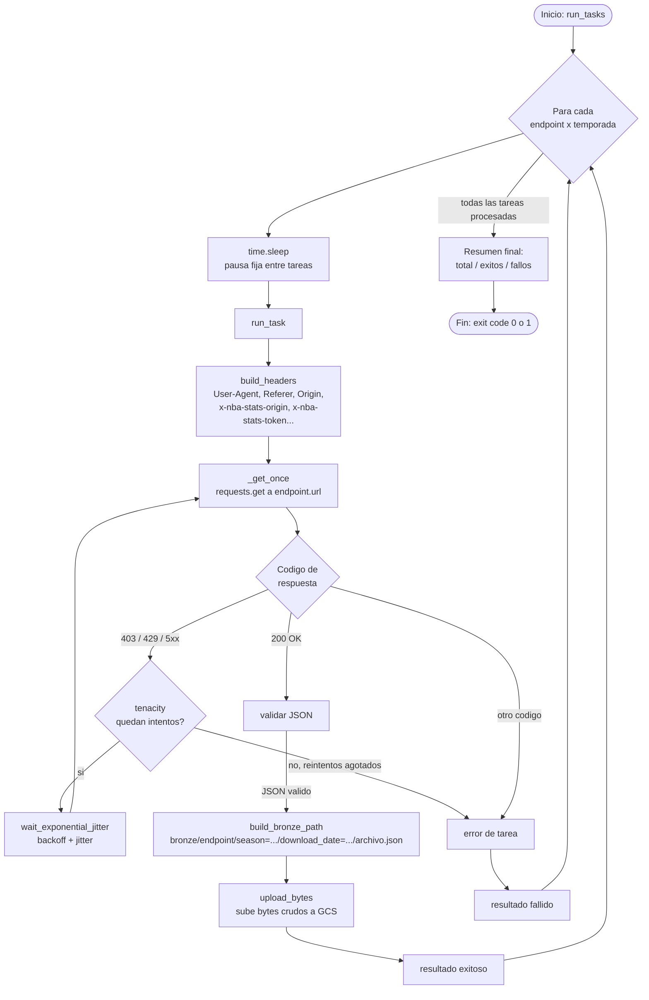

# Arquitectura — Fase 1: Ingesta Histórica a Bronze Layer

## Resumen

Esta fase implementa un script batch en Python 3.10+ que descarga las últimas 10
temporadas desde `stats.nba.com` y sube los JSON crudos (sin transformar) a un bucket
de Google Cloud Storage, organizados como capa Bronze particionada por endpoint,
temporada y fecha de descarga.

Se ejecuta como un único proceso de línea de comandos (`python -m nba_ingest`), sin
servicios ni framework. Dependencias: `requests` (HTTP), `tenacity` (reintentos),
`google-cloud-storage` (GCS) y `pytest` (tests). Los tests usan exclusivamente pytest
(funciones `test_*`, `assert`, `pytest.raises`, fixtures y `parametrize`); no se usa `unittest`.

El reto técnico central es evitar bloqueos del servidor de la NBA. Se combinan tres
mecanismos:
- **Headers HTTP** específicos de un navegador (`headers.py`).
- **Pausa fija entre tareas**: el orquestador espera `NBA_PAUSE_SECONDS` entre
  peticiones con `time.sleep`. Es un batch secuencial, así que no hace falta un
  limitador más sofisticado.
- **Reintentos con backoff exponencial** (`tenacity`) ante 403, 429 y 5xx, sin
  abortar el resto del batch.

El volumen de datos del jugador se obtiene con una sola petición por temporada al
endpoint `leaguegamelog` usando `PlayerOrTeam=P` (en vez de iterar por `PlayerID`).

## Flujo de una tarea de ingesta

## Organización del código

Paquete `src/nba_ingest/`, con módulos de funciones:

- **`config`** — variables de entorno: bucket, proyecto, User-Agent y pausa entre
  peticiones.
- **`catalog` / `endpoints.json`** — qué se descarga. Cada entrada define `url`
  absoluta, `fixedParams` y `seasonParamName`. La temporada no va en `fixedParams`.
- **`seasons`** — últimas 10 temporadas en formato `YYYY-YY`.
- **`headers`** — cabeceras que simulan un navegador. Único sitio a tocar si la NBA
  cambia sus requisitos.
- **`client`** — petición con `requests`, timeout explícito y reintentos con
  `@retry` de tenacity sobre un intento (`_get_once`). Valida JSON sin re-serializar.
- **`bronze_path`** — ruta particionada en GCS.
- **`gcs_uploader`** — subida con `google-cloud-storage`.
- **`ingest`** — orquestación: una tarea por endpoint × temporada, pausa entre tareas
  y continuación ante fallos parciales.

## Decisiones

- **Sin rate limiter propio.** Un `time.sleep` fijo entre tareas basta para un batch
  secuencial. Evita una dependencia y una clase de código que mantener.
- **Sin parseo de `Retry-After`.** El backoff exponencial de tenacity con jitter es
  suficiente para los 429.
- **Reintentos solo sobre estados transitorios.** Los 404 y otros códigos de error
  fallan de inmediato para no gastar peticiones.

## Estado actual

Módulos y tests unitarios implementados (35 tests pytest en `tests/unit/`, con `requests` y GCS simulados). Ejecución: `pytest`.

El catálogo `endpoints.json` contiene solo `leaguegamelog`, con los parámetros
indicados para la prueba. La prueba real contra `stats.nba.com` no ha conseguido
respuesta: el servidor cierra la conexión (`ConnectionResetError`) antes de devolver
un código HTTP. La verificación de endpoints (tarea 0, ver `docs/spike_endpoints.md`)
sigue pendiente.
