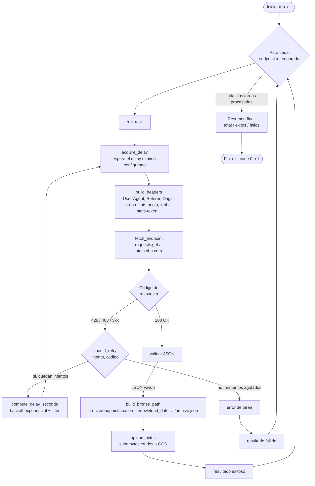

# Arquitectura — Fase 1: Ingesta Histórica a Bronze Layer

## Resumen

Esta fase implementa un script batch en Python 3.10+ que descarga las últimas 10
temporadas desde `stats.nba.com` y sube los JSON crudos (sin transformar) a un bucket
de Google Cloud Storage, organizados como capa Bronze particionada por endpoint,
temporada y fecha de descarga.

Se ejecuta como un único proceso de línea de comandos (`python -m nba_ingest`), sin
servicios ni framework. Dependencias: `requests` (HTTP), `google-cloud-storage` (GCS) y
`pytest` (tests).

El reto técnico central es evitar bloqueos del servidor de la NBA: se resuelve con
headers HTTP específicos, un *rate limiter* proactivo que espacía todas las peticiones,
y una política de reintentos con backoff exponencial que reacciona ante respuestas
429/403/5xx sin abortar el resto del batch.

El volumen de datos del jugador se obtiene con una sola petición por temporada al
endpoint `leaguegamelog` usando `PlayerOrTeam=P` (en vez de iterar por `PlayerID`),
lo que mantiene el batch completo en el orden de ~40 peticiones totales
(4 variantes de endpoint × 10 temporadas).

## Flujo de una tarea de ingesta

## Organización del código

Paquete `src/nba_ingest/`, con módulos de funciones:

- **`config`** — qué se descarga: rango de temporadas, catálogo de endpoints
  (`endpoints.json`) y configuración general (variables de entorno / overrides locales).
- **`http`** — cómo hablarle a `stats.nba.com` sin bloqueo: headers, rate limiting,
  reintentos y cliente HTTP basado en `requests`.
- **`storage`** — dónde y cómo se guarda en GCS: construcción del path particionado y
  subida con `google-cloud-storage`.
- **`ingest`** — orquestación: una tarea por combinación endpoint/temporada, que
  continúa el batch ante fallos parciales.
- **`util`** — utilidades mínimas sin lógica de negocio.

Los nombres concretos de módulos y funciones se fijarán al implementar cada paso, con
sus tests en `tests/` escritos antes.

## Estado actual

Módulos y tests unitarios implementados (55 tests, con `requests` y GCS simulados). El
catálogo `endpoints.json` está vacío: la verificación de endpoints (tarea 0, ver
`docs/spike_endpoints.md`) está pendiente, por lo que aún no se ejecuta ninguna
descarga real.
