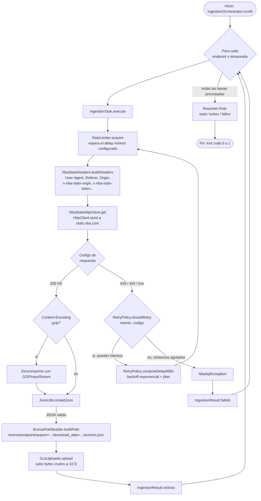

# Arquitectura — Fase 1: Ingesta Histórica a Bronze Layer

## Resumen

Esta fase implementa una aplicación batch en Java puro que descarga las últimas 10
temporadas desde `stats.nba.com` y sube los JSON crudos (sin transformar) a un bucket
de Google Cloud Storage, organizados como capa Bronze particionada por endpoint,
temporada y fecha de descarga.

El reto técnico central es evitar bloqueos del servidor de la NBA: se resuelve con
headers HTTP específicos (`NbaStatsHeaders`), un *rate limiter* proactivo
(`RateLimiter`) que espacía todas las peticiones, y una política de reintentos con
backoff exponencial (`RetryPolicy`) que reacciona ante respuestas 429/403/5xx sin
abortar el resto del batch.

El volumen de datos del jugador se obtiene con una sola petición por temporada al
endpoint `leaguegamelog` usando `PlayerOrTeam=P` (en vez de iterar por `PlayerID`),
lo que mantiene el batch completo en el orden de ~40 peticiones totales
(4 variantes de endpoint × 10 temporadas).

## Flujo de una tarea de ingesta

## Componentes por paquete

- **`config`** — qué se descarga: rango de temporadas (`SeasonRange`), catálogo de
  endpoints (`EndpointsCatalog`, `EndpointDefinition`) y configuración general
  (`AppConfig`).
- **`http`** — cómo hablarle a `stats.nba.com` sin bloqueo: headers (`NbaStatsHeaders`),
  rate limiting (`RateLimiter`), reintentos (`RetryPolicy`) y el cliente HTTP
  (`NbaStatsHttpClient`) que los integra.
- **`storage`** — dónde y cómo se guarda en GCS: construcción del path particionado
  (`BronzePathBuilder`) y subida (`GcsUploader`).
- **`ingest`** — orquestación: una tarea por combinación endpoint/temporada
  (`IngestionTask`, `IngestionResult`) coordinadas por `IngestionOrchestrator`, que
  continúa el batch ante fallos parciales.
- **`util`** — utilidades mínimas sin lógica de negocio (`JsonUtils`).

## Estado actual

Este documento corresponde al esqueleto inicial del proyecto: todas las clases
están definidas con sus firmas y JavaDoc, pero sin lógica interna implementada
(los métodos lanzan `UnsupportedOperationException`). La implementación se abordará
de forma iterativa en los siguientes pasos, siguiendo el orden de tareas de
`PLAN_FASE1.md`.
