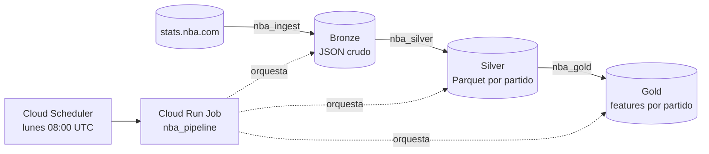

# Proyecto Baloncesto: pipeline de datos NBA en Google Cloud

[](https://github.com/ghe0034/proyecto_baloncesto/actions/workflows/ci.yml)

Pipeline de ingeniería de datos que extrae estadísticas de partidos de `stats.nba.com`, las transforma en tres capas (Bronze, Silver y Gold) sobre Google Cloud Storage y genera un dataset de features por partido sin data leakage, listo para modelar. Se ejecuta de forma programada en Cloud Run.


## Qué demuestra este proyecto

- **Ingesta resiliente:** cliente HTTP con huella TLS de navegador (`curl_cffi`), reintentos con backoff exponencial y jitter, timeouts explícitos y fallos parciales que no detienen el lote.
- **Arquitectura por capas:** JSON crudo en Bronze, Parquet tipado y deduplicado en Silver, features en Gold. Cada capa es reejecutable sin efectos secundarios.
- **Idempotencia por diseño:** rutas deterministas y reconstrucción por partición. Reejecutar un día, una ventana o una temporada produce el mismo resultado.
- **Features sin data leakage:** `shift(1)` antes de cada ventana móvil, con tests que mutan un partido y comprueban que su propia feature no cambia.
- **Orquestación fail-fast:** un único punto de entrada que encadena las etapas en orden estricto y se detiene ante el primer fallo.
- **Despliegue seguro:** imagen Docker `linux/amd64` sin secretos, usuario no-root, Service Account con privilegios mínimos sobre el bucket, y ejecución programada con Cloud Scheduler.
- **Calidad:** TDD con tests unitarios sin red ni GCS, linter `ruff` en pre-commit y en CI (GitHub Actions).

## Arquitectura



El diseño completo, con decisiones y limitaciones, está en [docs/ARCHITECTURE.md](docs/ARCHITECTURE.md).

## Capas de datos

| Capa | Ruta en GCS | Contenido |
|---|---|---|
| Bronze | `bronze/` y `bronze_incremental/` | JSON crudo de la API, particionado por endpoint, temporada y fecha de descarga |
| Silver | `silver/{tabla}/season=YYYY-YY/data.parquet` | 3 tablas tipadas, una fila por clave natural: `player_game_logs`, `team_game_logs`, `team_advanced_logs` |
| Gold | `gold/matchup_features/season=YYYY-YY/data.parquet` | Una fila por partido: medias móviles L5/L10, fatiga, diferenciales y targets |

### Gold: el dataset de partidos

- **Grano:** 1 fila por `game_id`, con las columnas del equipo local (`home_`) y del visitante (`away_`).
- **Features de forma:** medias móviles de los últimos 5 y 10 partidos de victoria, puntos, `plus_minus`, rating ofensivo y defensivo, pace, eFG%, TS%, pérdidas, rebotes ofensivos y PIE.
- **Features de jugadores:** proporción de puntos del equipo que anotan sus dos máximos anotadores.
- **Fatiga:** días de descanso, indicador de back-to-back y partidos en los últimos 7 días.
- **Diferenciales:** `diff_*` = local − visitante para cada feature.
- **Targets:** `home_win` y `target_point_diff`. El resultado del partido solo aparece como target.

Garantía anti-leakage: cada feature de un equipo se calcula agrupando por `(team_id, season_id)`, ordenando cronológicamente y aplicando `shift(1)` antes de la ventana. Los debuts de temporada quedan en NaN.

## Decisiones de ingeniería

| Decisión | Por qué |
|---|---|
| Incremental en prefijo separado (`bronze_incremental/`) | Mantiene la semántica de cada carga y nunca toca el histórico |
| Solape semanal de 10 días | Absorbe correcciones tardías de la API; es seguro porque Silver deduplica por clave |
| Deduplicación por `download_date` más reciente | Los ficheros incrementales traen subconjuntos de partidos, así que la deduplicación es por fila |
| Reconstrucción por partición en vez de `MERGE` | Más simple y determinista a este volumen (MB por temporada) |
| Lógica pura separada de la E/S | Los transformadores se testean sin GCS ni API; los clientes falsos viven en memoria |
| Ventana de fechas calculada una vez | Bronze, Silver y Gold usan la misma ventana aunque la ejecución cruce medianoche |
| Tag de imagen = SHA de git | Cada despliegue es reproducible y reversible |
| Service Account con `storage.objectAdmin` solo sobre el bucket | Mínimo privilegio; sin acceso al resto del proyecto |

## Stack

- **Lenguaje:** Python 3.10+ (CI en 3.14; imagen en 3.12)
- **Ingesta:** `curl_cffi`, `tenacity`
- **Datos:** `pandas`, `pyarrow` (Parquet con compresión snappy)
- **Nube:** Google Cloud Storage, Cloud Run Jobs, Cloud Scheduler, Artifact Registry
- **Calidad:** `pytest`, `ruff`, `pre-commit`, GitHub Actions
- **Contenedor:** Docker (`python:3.12-slim`, usuario no-root)

## Estructura del repositorio

```
src/
├── nba_ingest/      # Bronze: catálogo de endpoints, cliente HTTP, subida a GCS
├── nba_silver/      # Silver: parseo, validación, casteo y deduplicación
├── nba_gold/        # Gold: features por partido (features.py = lógica pura)
└── nba_pipeline/    # orquestador Bronze -> Silver -> Gold con fail-fast
tests/
├── unit/            # 213 tests sin red ni GCS
└── integration/     # prueba real contra stats.nba.com (marcador `integration`)
docs/                # arquitectura, planes por fase, guía de despliegue
Dockerfile
.dockerignore
pyproject.toml
```

## Puesta en marcha local

Requisitos: Python 3.10+, `gcloud` autenticado y un bucket de GCS.

```bash
python -m venv .venv
source .venv/bin/activate          # Windows: .venv\Scripts\activate
pip install -e ".[silver,dev]"

cp .env.example .env               # rellenar NBA_GCS_BUCKET y NBA_GCS_PROJECT
gcloud auth application-default login
```

Ejecución por capas:

```bash
python -m nba_ingest --seasons 1                 # Bronze: una temporada completa
python -m nba_ingest --days-back 10              # Bronze: ventana incremental
python -m nba_silver --season 2024-25            # Silver de una temporada
python -m nba_gold --season 2024-25              # Gold de una temporada
python -m nba_pipeline --days-back 10            # las tres capas, con fail-fast
```

Tests y lint:

```bash
pytest                    # tests unitarios
pytest -m integration     # prueba real contra la API
ruff check src tests
```

## Despliegue en Google Cloud

El pipeline se ejecuta como Cloud Run Job (2 Gi, timeout 3600 s) cada lunes a las 08:00 UTC mediante Cloud Scheduler. Los comandos exactos, la verificación de cada capa en GCS y el diagnóstico si la API bloquea las IPs de GCP están en [docs/deploy_gcp.md](docs/deploy_gcp.md).

## Calidad y verificación

- Tests unitarios para cada módulo, con HTTP y GCS simulados en memoria.
- Tests de anti-leakage en Gold: el partido actual no entra en su propia ventana, y los debuts quedan en NaN.
- Tests de regresión para casos reales: payloads vacíos, partidos suspendidos y huérfanos, back-to-backs y cambio de temporada.
- Pipeline de CI: lint y tests en cada push y pull request.

## Estado del proyecto

| Fase | Contenido | Estado |
|---|---|---|
| 1 | Ingesta histórica a Bronze | Completada: 3 endpoints × 31 temporadas en GCS, 0 fallos |
| 2 | Ingesta incremental y Silver | Implementada |
| 3 | Gold: features por partido | Implementada; pendiente de ejecución real en GCP |
| 4 | Orquestación, contenedor y despliegue | Código y tests hechos; pendiente de despliegue y ejecución real |

## Limitaciones conocidas

- Gold asume que `team_advanced_logs` incluye todas las métricas de `ADVANCED_METRICS` (verificado en las 31 temporadas 1996-97 a 2026-27).
- `stats.nba.com` puede limitar el tráfico desde IPs de centros de datos. Hay plan de diagnóstico documentado.
- No hay alertas automáticas; el fallo queda en los logs de Cloud Run.
- Solo temporada regular.

## Aviso

Proyecto educativo. Los datos pertenecen a la NBA y a `stats.nba.com`; respetar sus condiciones de uso y no sobrecargar el servicio.
