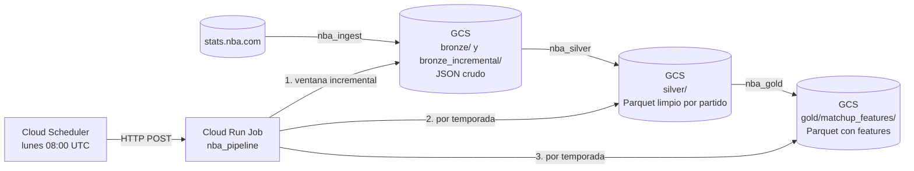
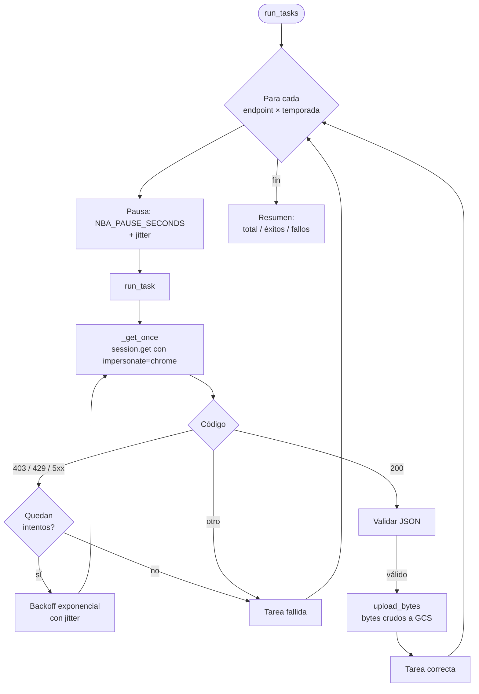

# Arquitectura

Pipeline batch que descarga datos de `stats.nba.com`, los guarda en tres capas en Google Cloud Storage (Bronze → Silver → Gold) y se ejecuta de forma programada en Cloud Run. Planes por fase: [PLAN_FASE1.md](PLAN_FASE1.md), [PLAN_FASE2.md](PLAN_FASE2.md), [PLAN_FASE3.md](PLAN_FASE3.md), [PLAN_FASE4.md](PLAN_FASE4.md).

## Visión general

Cada capa es un paquete Python independiente con su propia CLI (`python -m nba_ingest`, `nba_silver`, `nba_gold`). `nba_pipeline` las encadena en orden estricto y se detiene ante el primer fallo.

## Capas en GCS

| Capa | Ruta | Contenido | Escritura |
|---|---|---|---|
| Bronze (histórico) | `bronze/{endpoint}/season={s}/download_date={d}/{endpoint}.json` | JSON crudo de una temporada completa | Sobrescribe el objeto del mismo día |
| Bronze (incremental) | `bronze_incremental/{endpoint}/season={s}/date_from={a}/date_to={b}/download_date={d}/{endpoint}.json` | JSON crudo de una ventana de fechas | Sobrescribe el objeto de la misma ventana y día |
| Silver | `silver/{tabla}/season={s}/data.parquet` | Una fila por clave natural (partido × equipo o jugador) | Reconstruye la temporada completa |
| Gold | `gold/matchup_features/season={s}/data.parquet` | Una fila por partido: features pre-partido y targets | Reconstruye la temporada completa |

Bronze nunca se modifica en las capas superiores. Las cargas incrementales nunca escriben bajo `bronze/`.

## Principios de diseño

- **Lógica pura separada de la E/S.** Las funciones de transformación (`transform.py`, `features.py`, `date_range.py`) reciben DataFrames o cadenas y devuelven resultados sin tocar red ni disco. La E/S vive en módulos finos (`gcs_io.py`, `client.py`, `gcs_uploader.py`). Esto permite testear la lógica sin GCS ni API.
- **Idempotencia.** Cada objeto tiene una ruta determinista. Reejecutar un día, una ventana o una temporada sobrescribe el mismo objeto con el mismo contenido. Por eso los reintentos automáticos son seguros.
- **Sin data leakage en Gold.** Toda feature de un partido se calcula solo con partidos anteriores de ese equipo, en su temporada. Ver [Gold](#gold-nba_gold).
- **Fail-fast en la orquestación.** Si una etapa devuelve un código distinto de 0 o lanza una excepción, el pipeline se detiene y la ejecución queda marcada como fallida.
- **Mínimo privilegio.** La Service Account del job tiene `storage.objectAdmin` solo sobre el bucket. El scheduler solo puede invocar el job. La imagen corre como usuario no-root y no contiene credenciales.
- **Tests primero (TDD).** Cada módulo tiene tests unitarios sin red ni GCS, con clientes falsos en memoria.

## Bronze (`nba_ingest`)

Descarga JSON de stats.nba.com y lo sube sin transformar.

### Módulos

- **`catalog.py` / `endpoints.json`** — catálogo de endpoints. Cada entrada define `url`, `fixedParams` y `seasonParamName`. Añadir una variante no requiere código. Solo contiene parámetros verificados en `docs/spike_endpoints.md`.
- **`seasons.py`** — temporadas `YYYY-YY`. Cambian el 1 de octubre.
- **`date_range.py`** — `DateRange`, `days_back_range`, `seasons_for_range` (una ventana que cruza el 1 de octubre produce 2 temporadas) y formato `MM/DD/YYYY` de la API.
- **`headers.py`** — cabeceras de dominio (`Accept`, `Origin`, `Referer`). `curl_cffi` con `impersonate="chrome"` genera `User-Agent` y `Sec-Ch-Ua*`.
- **`client.py`** — `build_request_params` (sobrescribe `DateFrom`/`DateTo` si hay rango) y `fetch_endpoint` con timeout explícito y reintentos (`tenacity`) sobre un único intento (`_get_once`).
- **`bronze_path.py`** — `build_bronze_path` y `build_incremental_bronze_path`.
- **`gcs_uploader.py`** — `make_bucket` y `upload_bytes` con `google-cloud-storage`.
- **`ingest.py`** — `build_tasks` (endpoint × temporada), `run_task`, `run_tasks` (pausa con jitter entre tareas y continuación ante fallos parciales), `all_succeeded`.
- **`__main__.py`** — CLI: `--seasons N`, `--days-back N` o `--date-from/--date-to`, mutuamente excluyentes. Exit code 0 solo si todas las tareas terminan bien.

### Flujo de una tarea

### Reintentos y huella

- Reintenta solo 403, 429 y 5xx, hasta 5 intentos con backoff exponencial y jitter. Los 404 y otros códigos fallan de inmediato.
- Pausa con jitter entre tareas. Es un batch secuencial, así que no hace falta un limitador de tasa.
- `Retry-After` no se parsea: el backoff exponencial basta.

## Silver (`nba_silver`)

Convierte los JSON de Bronze en Parquet tabular, uno por tabla y temporada.

| Bronze (`endpoint`) | Silver (tabla) | Clave natural |
|---|---|---|
| `leaguegamelog` | `player_game_logs` | `game_id`, `player_id` |
| `leaguegamelog_teams` | `team_game_logs` | `game_id`, `team_id` |
| `teamgamelogs_advanced` | `team_advanced_logs` | `game_id`, `team_id` |

### Módulos

- **`schemas.py`** — `TableSpec` (dataclass inmutable) con nombre, endpoint, clave, columnas obligatorias y tipos. Es la única fuente de verdad del esquema.
- **`transform.py`** — lógica pura: `parse_nba_json` (cabeceras + `rowSet` → DataFrame), `clean_dataframe` (valida, castea y deriva `is_home` desde `MATCHUP`), `parse_minutes_to_decimal` (`"32:30"` → `32.5`) y `deduplicate`.
- **`gcs_io.py`** — lectura de fragmentos de ambos prefijos (`bronze/` y `bronze_incremental/`), descubrimiento de temporadas y escritura del Parquet.
- **`pipeline.py`** — `process_season` (leer → limpiar → deduplicar → escribir) y `run_pipeline`.
- **`__main__.py`** — CLI: `--season YYYY-YY` o `--all-seasons`, y `--table` opcional.

### Reglas

- **Payloads vacíos no fallan.** Un fragmento sin filas (p. ej., una semana sin partidos) se ignora antes de validar columnas.
- **Validación de columnas obligatorias.** Si falta una, se lanza `SchemaValidationError`: la API ha cambiado.
- **Casteo explícito.** Ids como `string` para no perder ceros a la izquierda, fechas como `date`, enteros como `Int64` nullable y métricas como `float64`.
- **Minutos `MM:SS`.** Las temporadas antiguas los envían así; se convierten a decimal antes de castear.
- **Deduplicación por clave.** Si la misma clave aparece en varias descargas, gana la de `download_date` más reciente. Necesario porque los ficheros incrementales solo contienen un subconjunto de partidos.
- **Sin escritura vacía.** Si una temporada no tiene filas, no se escribe nada (`SALTADO` en el resumen).

### Particionado e idempotencia

Cada ejecución lee todo el Bronze de la temporada, reconstruye la tabla completa, ordena por clave y sobrescribe `silver/{tabla}/season={s}/data.parquet`. Es determinista y no deja ficheros huérfanos. A este volumen (MB por temporada) es más simple que un `MERGE`.

## Gold (`nba_gold`)

Dataset de features por partido, listo para modelar. Una fila por `game_id`.

### Grano y garantía anti-leakage

- Se cruza el lado local (`is_home == True`, prefijo `home_`) con el visitante (`is_home == False`, prefijo `away_`).
- Las features de cada equipo se calculan agrupadas por `(team_id, season_id)`, ordenadas por `(game_date, game_id)`.
- **`shift(1)` antes de `rolling`.** La ventana nunca incluye el partido actual. Es la garantía central de la capa y tiene tests dedicados que mutan el marcador de un partido y comprueban que sus propias features no cambian.
- El cruce home/away se hace después de calcular las features por equipo.
- Partidos sin `wl`, huérfanos (un solo lado), suspendidos o con lados duplicados se descartan.

### Features

- **Medias móviles** de los últimos 5 y 10 partidos (`min_periods=1`) sobre `win`, `pts`, `plus_minus`, `off_rating`, `def_rating`, `net_rating`, `pace`, `efg_pct`, `ts_pct`, `tm_tov_pct`, `oreb_pct`, `pie` y `top2_pts_share`.
- **`top2_pts_share`** — proporción de los puntos del equipo que anotan sus 2 máximos anotadores en el partido. Se calcula con la tabla de jugadores y luego se desplaza como el resto.
- **Fatiga** — `rest_days` (días desde el partido anterior), `is_b2b` (un día de descanso) y `games_last_7d` (partidos en los 7 días naturales previos).
- **Diferenciales** — `diff_{feature}` = local − visitante.
- **Targets** — `home_win` y `target_point_diff`. El resultado del partido solo aparece aquí.

### Módulos

- **`features.py`** — lógica pura, componible: `build_team_game_base`, `add_player_signal`, `add_rolling_features`, `add_rest_features`, `pivot_home_away`, `add_diffs_and_targets` y el orquestador `build_matchup_features`.
- **`gcs_io.py`** — lectura de las tres tablas Silver, descubrimiento de temporadas y escritura. Reutiliza `make_bucket` y las rutas de `nba_silver`.
- **`pipeline.py`** — `process_season`: si falta una tabla o no hay filas, no escribe.
- **`__main__.py`** — CLI: `--season YYYY-YY` o `--all-seasons`.

## Orquestación (`nba_pipeline`)

Punto de entrada único: `python -m nba_pipeline --days-back 10`.

1. Calcula la ventana `[hoy − N días, hoy]` en UTC **una sola vez** y la pasa a Bronze como `--date-from/--date-to`. Así todas las etapas usan la misma ventana aunque la ejecución cruce medianoche.
2. Deriva las temporadas de esa ventana con `seasons_for_range`. Una semana normal toca 1 temporada; una ventana que cruza el 1 de octubre toca 2.
3. Ejecuta en orden: Bronze → Silver de cada temporada → Gold de cada temporada.
4. Ante un código distinto de 0 se detiene y devuelve 1. Las excepciones no se capturan: Cloud Run las registra como fallo.

Las etapas se inyectan como funciones (`run_pipeline` recibe las tres `main`), así que el orden y el fail-fast se testean sin red.

### Contenedor y despliegue

- **Imagen:** `python:3.12-slim` para `linux/amd64`, instalación con `pip install ".[silver]"`, usuario `appuser` (uid 10001). `.dockerignore` excluye `.env`, `.git`, `tests`, `docs` y credenciales.
- **Cloud Run Job** `nba-pipeline`: 2 Gi de memoria, timeout de 3600 s y `--max-retries 1` (seguro por idempotencia).
- **Cloud Scheduler** `nba-pipeline-weekly`: `0 8 * * 1` en UTC.
- **Artifact Registry** para las imágenes, con tag = SHA corto de git.

Comandos completos y verificación en [deploy_gcp.md](deploy_gcp.md).

## Decisiones

| Decisión | Motivo |
|---|---|
| Incremental en prefijo propio (`bronze_incremental/`) | No mezcla semánticas de carga completa e incremental; permite políticas de ciclo de vida distintas |
| Reconstrucción por partición en vez de `MERGE` | Más simple y determinista a este volumen; sin estado intermedio que gestionar |
| Solape semanal (`--days-back 10`) | Absorbe correcciones tardías de la API; es seguro porque Silver deduplica |
| `shift(1)` antes de `rolling` | Hace imposible el leakage por construcción, no por revisión manual |
| Debut de temporada en NaN (sin arrastre) | Evita mezclar rendimientos de plantillas y reglas distintas; el modelo decide cómo tratar NaN |
| `curl_cffi` con `impersonate="chrome"` | `requests` es rechazado por el TLS de stats.nba.com |
| Fail-fast entre capas | Una capa incompleta no debe producir features sobre datos parciales |
| Tag de imagen = SHA de git | Despliegues reproducibles y reversibles |

## Limitaciones conocidas

- **Dependencia de columnas.** Gold asume que `team_advanced_logs` incluye todas las métricas de `ADVANCED_METRICS` (verificado en las 31 temporadas 1996-97 a 2026-27). Silver valida solo las columnas obligatorias y no crea las que falten, así que una temporada futura con columnas ausentes fallaría con `KeyError` en Gold en lugar de degradar.
- **Bloqueo de IPs de GCP.** stats.nba.com puede limitar tráfico desde centros de datos. Hay plan de diagnóstico en [deploy_gcp.md](deploy_gcp.md#8-diagnóstico-stats-nba-com-bloquea-ips-de-gcp).
- **Sin alertas.** El fallo queda en los logs y en el estado de la ejecución; no hay notificación automática.
- **Solo temporada regular.** `SeasonType` está fijo en `Regular Season`.

## Estado

| Fase | Contenido | Estado |
|---|---|---|
| 1 | Ingesta histórica a Bronze | Completada. Backfill de 3 endpoints × 31 temporadas en GCS, 0 fallos |
| 2 | Ingesta incremental y Silver | Implementada |
| 3 | Gold: features por partido | Implementada. Pendiente de ejecución real en GCP |
| 4 | Orquestación, contenedor y despliegue | Código y tests hechos. Pendiente: build de la imagen, despliegue y ejecución real |

Suite de tests unitarios: 213 tests (`pytest -m "not integration"`), con CI en GitHub Actions (ruff + pytest).
