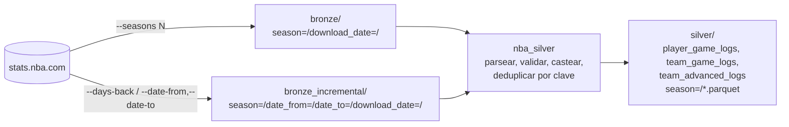

# Arquitectura — Fase 1: Ingesta Histórica a Bronze Layer (+ Fase 2 al final)

La Fase 2 (ingesta incremental y capa Silver) se describe en [Fase 2](#fase-2-ingesta-incremental-y-capa-silver); plan detallado en [PLAN_FASE2.md](PLAN_FASE2.md).

## Resumen

Esta fase implementa un script batch en Python 3.10+ que descarga las últimas 10
temporadas desde `stats.nba.com` y sube los JSON crudos (sin transformar) a un bucket
de Google Cloud Storage, organizados como capa Bronze particionada por endpoint,
temporada y fecha de descarga.

Se ejecuta como un único proceso de línea de comandos (`python -m nba_ingest`), sin
servicios ni framework. Dependencias: `curl_cffi` (HTTP con `impersonate="chrome"`), `tenacity` (reintentos),
`google-cloud-storage` (GCS) y `pytest` (tests). Los tests usan exclusivamente pytest
(funciones `test_*`, `assert`, `pytest.raises`, fixtures y `parametrize`); no se usa `unittest`.

El reto técnico central es evitar bloqueos del servidor de la NBA. Se combinan tres
mecanismos:
- **Huella de navegador**: `curl_cffi` con `impersonate="chrome"` aporta TLS, User-Agent y `Sec-Ch-Ua*`; `headers.py` añade solo `Accept`, `Origin` y `Referer`.
- **Pausa con jitter entre tareas**: el orquestador espera `NBA_PAUSE_SECONDS` más un
  aleatorio en [0, `NBA_PAUSE_JITTER_SECONDS`] entre peticiones con `time.sleep`. Es un batch secuencial, así que no hace falta un
  limitador más sofisticado.
- **Reintentos con backoff exponencial** (`tenacity`) ante 403, 429 y 5xx, sin
  abortar el resto del batch.

El volumen de datos del jugador se obtiene con una sola petición por temporada al
endpoint `leaguegamelog` usando `PlayerOrTeam=P` (en vez de iterar por `PlayerID`).

## Flujo de una tarea de ingesta

```mermaid
flowchart TD
    Start([Inicio: run_tasks]) --> Loop{Para cada<br/>endpoint x temporada}
    Loop --> Pause[time.sleep<br/>pausa + jitter entre tareas]
    Pause --> Task[run_task]

    Task --> Headers[build_headers<br/>Accept, Origin, Referer<br/>(UA y Sec-Ch-Ua los pone impersonate)]
    Headers --> Send[_get_once<br/>session.get(impersonate=chrome)<br/>a endpoint.url]

    Send --> Status{Codigo de<br/>respuesta}

    Status -->|200 OK| Validate[validar JSON]

    Status -->|403 / 429 / 5xx| Retry{tenacity<br/>quedan intentos?}
    Retry -->|si| Backoff[wait_exponential_jitter<br/>backoff + jitter]
    Backoff --> Send
    Retry -->|no, reintentos agotados| Fail[error de tarea]

    Status -->|otro codigo| Fail

    Validate -->|JSON valido| BuildPath[build_bronze_path<br/>bronze/endpoint/season=.../download_date=.../archivo.json]
    BuildPath --> Upload[upload_bytes<br/>sube bytes crudos a GCS]
    Upload --> Success[resultado exitoso]

    Fail --> ResultFail[resultado fallido]

    Success --> Loop
    ResultFail --> Loop

    Loop -->|todas las tareas procesadas| Summary[Resumen final:<br/>total / exitos / fallos]
    Summary --> End([Fin: exit code 0 o 1])
```

## Organización del código

Paquete `src/nba_ingest/`, con módulos de funciones:

- **`config`** — variables de entorno: bucket, proyecto, User-Agent opcional, pausa,
  jitter y número de temporadas (`NBA_SEASONS_COUNT`, por defecto 10).
- **`catalog` / `endpoints.json`** — qué se descarga. Cada entrada define `url`
  absoluta, `fixedParams` y `seasonParamName`. La temporada no va en `fixedParams`.
- **`seasons`** — últimas 10 temporadas en formato `YYYY-YY`.
- **`headers`** — cabeceras de dominio (`Accept`, `Origin`, `Referer`). Único sitio a tocar si la NBA
  cambia sus requisitos.
- **`client`** — petición con la sesión `curl_cffi` (inyectada), timeout explícito y reintentos con
  `@retry` de tenacity sobre un intento (`_get_once`). Valida JSON sin re-serializar.
- **`bronze_path`** — ruta particionada en GCS.
- **`gcs_uploader`** — subida con `google-cloud-storage`.
- **`__main__`** — CLI (`--seasons N` prevalece sobre `NBA_SEASONS_COUNT`); abre la sesión HTTP con
  context manager y la cierra al terminar. Credenciales GCS por ADC (`gcloud auth application-default login`).
- **`ingest`** — orquestación: una tarea por endpoint × temporada, pausa con jitter entre tareas
  y continuación ante fallos parciales.

## Decisiones

- **Sin rate limiter propio.** Un `time.sleep` con jitter entre tareas basta para un batch
  secuencial. Evita una dependencia y una clase de código que mantener.
- **Sin parseo de `Retry-After`.** El backoff exponencial de tenacity con jitter es
  suficiente para los 429.
- **Reintentos solo sobre estados transitorios.** Los 404 y otros códigos de error
  fallan de inmediato para no gastar peticiones.

## Estado actual

Módulos y tests unitarios implementados (44 tests pytest en `tests/unit/`, con HTTP y GCS simulados). Ejecución: `pytest`. Prueba real contra la API: `pytest -m integration`.

El catálogo `endpoints.json` contiene `leaguegamelog`, `leaguegamelog_teams` y
`teamgamelogs_advanced`, verificados con HTTP 200 (ver `docs/spike_endpoints.md`). El
cierre de conexión TLS que daba `requests` se resolvió con `curl_cffi` e
`impersonate="chrome"`. El ensayo E2E y el backfill histórico están completados en GCS
(3 endpoints × 31 temporadas = 93 tareas, 0 fallos).

## Fase 2: ingesta incremental y capa Silver

Estado: planificada, sin implementar. Se construye sobre Bronze sin modificar el modo histórico.



### Entorno
`pyproject.toml` (layout `src`, `pip install -e ".[silver,dev]"`) sustituye a `PYTHONPATH=src`.
`python-dotenv` carga un `.env` local (ignorado por git, plantilla `.env.example`) en `__main__`,
no en `config.load_settings`, que sigue siendo una función pura sobre un `Mapping`. Las variables
reales del entorno prevalecen sobre `.env`.

### Ingesta incremental (Bronze)
- CLI: `--seasons N` (histórico), `--days-back N` o `--date-from/--date-to`, mutuamente excluyentes.
- Módulo nuevo `date_range`; `catalog` añade los nombres de parámetro de fecha (`DateFrom`/`DateTo`
  por defecto); `client.build_request_params` sobrescribe esos parámetros con el rango en formato
  `MM/DD/YYYY`; `IngestionTask` lleva un `date_range` opcional; `bronze_path` añade la ruta incremental.
- Ruta: `bronze_incremental/{endpoint}/season=/date_from=/date_to=/download_date=/{endpoint}.json`.
  Prefijo propio para que nunca colisione con los ficheros de temporada completa.
- **Idempotencia:** misma ventana y mismo día sobrescriben el mismo objeto. Se recomienda un solape
  semanal (`--days-back 10`); es seguro porque Silver deduplica por clave.
- Una ventana que cruza el 1 de octubre genera tareas para 2 temporadas.

### Capa Silver (`src/nba_silver/`)
Paquete separado con dependencias `pandas` y `pyarrow` (extra `silver`), CLI `python -m nba_silver`.

| Bronze | Silver | Clave |
|---|---|---|
| `leaguegamelog` | `silver/player_game_logs/` | `GAME_ID`, `PLAYER_ID` |
| `leaguegamelog_teams` | `silver/team_game_logs/` | `GAME_ID`, `TEAM_ID` |
| `teamgamelogs_advanced` | `silver/team_advanced_logs/` | `GAME_ID`, `TEAM_ID` |

- **Módulos:** `tables` (definición de tablas), `bronze_reader`, `parsing`, `transform`, `dedupe`,
  `silver_path`, `parquet_writer`, `pipeline`.
- **Reglas:** payloads vacíos se ignoran; el esquema se valida (columnas obligatorias vs. opcionales,
  estas últimas nulas en temporadas antiguas); se castean fechas, métricas numéricas y se derivan
  `is_home` (desde `MATCHUP`) e `is_win` (desde `WL`).
- **Deduplicación:** a nivel de fila por clave primaria, gana el mayor `download_date` (desempate por
  `blob.updated`). Necesario porque los ficheros incrementales solo contienen un subconjunto de partidos.
- **Particionado e idempotencia:** `silver/{tabla}/season={s}/{tabla}.parquet`. Cada ejecución
  reconstruye la partición completa de la temporada desde todo su Bronze y sobrescribe un único
  objeto de nombre fijo, con filas ordenadas por clave: resultado determinista, sin ficheros huérfanos.
- **E/S:** `google-cloud-storage` para leer y escribir (sin `gcsfs`); el Parquet se serializa con
  `pyarrow` a `BytesIO`.

### Decisiones y límites
- Incremental en prefijo separado en vez de mezclar con `bronze/`: mantiene la semántica de cada capa
  y permite políticas de ciclo de vida distintas.
- Reconstrucción por partición en vez de `MERGE`/upsert: más simple y idempotente a este volumen
  (~0,3–10 MB por temporada y tabla).
- Fuera de alcance: Playoffs (`SeasonType` fijo en `Regular Season`), orquestación y capa Gold.
- Los parámetros de fecha y el esquema Silver se confirman con un spike previo antes de codificar
  (ver `PLAN_FASE2.md`, Paso 0).
